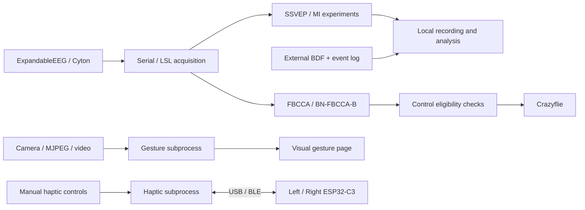

<div align="center">

<h1>Brain–Drone Swarm Console · V2.1</h1>
<h3>脑控无人机蜂群上位机</h3>

<p>一个桌面工作台，连接脑电采集、实验分析、无人机控制、视觉手势与双手触觉反馈。</p>
<p>A desktop workspace for EEG, BCI experiments, drone control, camera gestures and dual-hand haptics.</p>

<p>
  <a href="#zh-cn"></a>
  <a href="#english"></a>
</p>

<p>
  
  
  
  
  
</p>

<p>
  <a href="#quick-start">快速开始</a> ·
  <a href="#workspaces">工作空间</a> ·
  <a href="#architecture">系统架构</a> ·
  <a href="#repository-scope">仓库与数据</a> ·
  <a href="#third-party">来源声明</a>
</p>

</div>

---

<a id="zh-cn"></a>

## 简体中文

### 项目概览

**Brain–Drone Swarm Console V2.1** 是基于 Python 3.12 与 PySide6 的桌面上位机，面向脑机接口实验、设备联调和科研数据分析。它将 EEG 采集、SSVEP / 运动想象（MI）实验、Crazyflie 操控、摄像头手势识别和双手触觉控制放在同一套黑白灰界面中。

| 项目 | 说明 |
| --- | --- |
| 当前版本 | **V2.1** |
| 使用身份 | 士兵 / 作战操作员、指挥官、科研人员 |
| 界面 | PySide6 桌面应用；士兵左侧折叠导航，科研顶部独立导航 |
| 脑电接入 | ExpandableEEG / Cyton 兼容串口、LSL、CSV 回放、外部 BDF 导入 |
| 在线解码 | 采集模式配置 FBCCA 或 BN-FBCCA-B |
| 无人机 | Crazyflie / Crazyradio，Flow 与 Lighthouse 相关控制 |
| 触觉设备 | ESP32-C3 + DRV2605L，左右手独立 USB / BLE 连接 |
| 数据存储 | 本地记录与分析；科研数据、报告和实验结果不随仓库发布 |

### V2.1 功能亮点

| 模块 | 能力 |
| --- | --- |
| **采集与回放** | 通道波形、频谱、信号质量、丢包检查、LSL 广播与收集、CSV 保存与回放 |
| **实验工作流** | SSVEP、MI、串行联合实验；受试者管理、正式任务、试跑、静息、事件与试次归档 |
| **固定解码流程** | 先选采集模式，再调整 FBCCA 参数；参数随实验记录保存，分析时可追溯 |
| **数据分析** | 按受试者、日期、动作和试次筛选；BDF 对齐导入；联合阶段配对分析 |
| **驾驶与操控** | URI 配置、实时链路、手动摇杆、编队、受控降落和放大居中的紧急停止按钮 |
| **视觉手势** | 本机摄像头、MJPEG、视频文件；实时画面、帧差事件、11 类 SNN 结果和推理耗时 |
| **触觉反馈** | 独立页面；左右手强度调节、单手 / 双手启停、ROM 效果、I²C 诊断与通信日志 |

<a id="workspaces"></a>

### 工作空间

**士兵 / 指挥官**使用左侧导航。鼠标靠近左边自动展开，离开后收起，也可手动固定。

| 页面 | 用途 |
| --- | --- |
| 作战地图 | 查看飞行器位置和链路概览 |
| 脑控驾驶 | 连接实机、配置 URI、手动操控和启动 SSVEP 链路 |
| 视觉手势 | 摄像头预览、手势识别与指令提示 |
| 触觉反馈 | 手动连接与控制左右手振动设备 |
| 状态监控 | 查看操作员与系统状态信息 |

**科研人员**保留顶部六个独立入口：`采集` → `LSL收集` → `CSV回放` → `数据采集` → `数据分析` → `SSVEP测试`。采集模式在采集页直接确定，高级设置用于调节解码参数。

<a id="architecture"></a>

### 系统架构



界面、流程控制、业务服务和设备适配分层组织。摄像头推理与触觉通信运行在独立进程；手势目前提供识别提示，触觉由用户手动操作，两者均未自动关联飞控指令。

<a id="quick-start"></a>

### 快速开始

准备 **Python 3.12** 和桌面图形环境，从项目根目录运行以下命令。已有 `.venv312` 时可复用。

```bash
git clone https://github.com/lzynb0206/brain-drone-swarm-console.git
cd brain-drone-swarm-console
```

<details open>
<summary><strong>macOS / Linux</strong></summary>

```bash
python3.12 -m venv .venv312
.venv312/bin/python -m pip install -r requirements.txt
.venv312/bin/python main.py
```

</details>

<details>
<summary><strong>Windows PowerShell</strong></summary>

```powershell
py -3.12 -m venv .venv312
.\.venv312\Scripts\python.exe -m pip install -r requirements.txt
.\.venv312\Scripts\python.exe main.py
```

</details>

按功能安装可选依赖；USB 触觉连接已使用基础依赖中的 `pyserial`。

| 功能 | 安装命令（macOS / Linux） |
| --- | --- |
| 摄像头与 SNN 识别 | `.venv312/bin/python -m pip install -r requirements-vision.txt` |
| BLE 触觉设备 | `.venv312/bin/python -m pip install -r requirements-haptics.txt` |
| 模型训练与离线开发 | `.venv312/bin/python -m pip install -r requirements-ml.txt` |

Windows 将上述 Python 路径替换为 `.\.venv312\Scripts\python.exe`。

**进入界面：**输入 `soldier` 或 `research` 可通过本地调试入口进入相应工作空间，无需密码。其他账号默认使用独立部署的 Spring Boot / JWT 认证服务。正常启动不会自动启用飞控或连接触觉设备。

### 采集与实验

#### 1. 先选择采集模式

| 模式 | 数据来源与接线 | 解码 / 分析 |
| --- | --- | --- |
| **纯 SSVEP · 8 通道** | 本机 EEG；O1、Oz、O2、PO3、POz、PO4、P3、P4 | FBCCA，无需加载模型 |
| **SSVEP + MI · 5+3** | 本机 EEG；O1、Oz、O2、P3、P4 + C3、Cz、C4 | SSVEP 固定 BN-FBCCA-B；MI 离线分析 |
| **32 通道 · 外部 BDF** | 外部设备录制 BDF，本机呈现刺激并保存事件 | 导入时按名称选通道并确认时间对齐 |

实验参数、接线与信号、高级设置默认折叠。高级设置可调整谐波数、滤波方式、分数与差值门限；每种模式在当前软件会话内保留自己的设置，实验记录包含实际使用参数。数据流或实验运行时锁定相关配置。

#### 2. 完成一轮采集

1. 在“采集”选择模式和串口设备，进入会话后查看波形、频谱与信号质量。
2. 需要共享数据流时启动 LSL 输出，在“LSL收集”接收并保存 CSV；已有数据可在“CSV回放”中暂停、调速和定位。
3. 打开“数据采集”，确认受试者，选择正式任务、试跑或静息，并核对采集计划。
4. 完成采集后，在“数据分析”按受试者、日期、实验类型、动作和试次查看结果。

**外部 BDF：**32 通道模式沿用外部采集流程，不实时接收本机 32 通道信号。保留 BDF 与同轮事件日志，导入时填写时间偏移、漂移和对齐依据；人工对齐会标记为未验证，不能等同于硬件同步。

### 设备使用

<details open>
<summary><strong>Crazyflie / 脑控驾驶</strong></summary>

在“脑控驾驶”配置 URI、连接实机，再启动 SSVEP 实时链路。URI 输入支持灰色提示 `radio://0/80/2M/E7E7E7E704`，按 Tab 可补全。

```text
ExpandableEEG → LSL → EEGWorker → 解码 → 飞控准入检查 → Crazyflie
```

页面提供手动操控、受控降落和紧急停止。真实飞控需要显式开启硬件控制；CSV 回放、模拟信号和未经独立验证的模型不能直接进入实机脑控执行链路。

</details>

<details>
<summary><strong>摄像头 / 视觉手势</strong></summary>

1. 安装视觉依赖，打开“视觉手势”。
2. 选择本机摄像头编号、完整 MJPEG 地址（如 `http://设备IP/stream`）或视频文件。
3. 使用 `models/dvs128_snn_best_v4.pth`，点击“连接并识别”。
4. 查看画面、事件图、类别与耗时；停止后可调整帧差阈值及旋转角度。

该权重约 **6.5 MB**，是手势功能的运行资源。SNN 发放率是原始分数，DVS 数据集表现不代表普通摄像头准确率。退出登录或关闭软件会停止摄像头进程。

</details>

<details>
<summary><strong>ESP32-C3 / 双手触觉反馈</strong></summary>

使用 [haptic-feedback-console V0.2 配套固件](https://github.com/xiezhi0819-stack/haptic-feedback-console#1-接线与烧录)，协议版本为 **4**，左右板分别为 `Haptic-Left`、`Haptic-Right`。本项目直接使用 Python 后端逻辑，无需启动 JavaFX。

1. 打开独立的“触觉反馈”页面，左右手分别选择 USB 或 BLE，刷新设备列表并连接。
2. 调整目标强度 **0–127**，点击“开始 / 应用强度”；滑条与预设只改变目标值，0 表示停止。
3. “双手启动”使用各手的非零强度；“全部停止”分别报告每手结果。
4. 展开“效果与诊断”可播放 **0–123** 的 ROM 效果、查询状态和检测 I²C；通信日志默认折叠。

支持双 USB、双 BLE 和混合连接。USB 使用 Windows COM 或 macOS/Linux 枚举端口；BLE 需要相应依赖和系统权限。振动、实际强度和驱动状态来自板端回报。

后台校验手别、请求 ID 和确认结果。退出登录、关闭窗口或界面心跳中断时会请求停止并断开；固件失去控制通道心跳约 3 秒后停止振动。“停止未确认”不能视为硬件已停止，真实双设备与马达仍需实机联调。

</details>

### 配置参考

程序读取进程环境变量，**不会自动加载 `.env`**。完整示例见 [`.env.example`](.env.example)，下表为代码默认值。

<details>
<summary><strong>展开环境变量与离线认证示例</strong></summary>

| 变量 | 默认值 | 用途 |
| --- | --- | --- |
| `BDS_AUTH_BACKEND` | `http` | 后端认证；`mock` 用于离线演示 |
| `AUTH_API_URL` | `http://127.0.0.1:8080` | 认证服务地址 |
| `BDS_EEG_BACKEND` | `lsl` | EEG 初始数据源；`csv` 为显式回放 |
| `BDS_LSL_STREAM_NAME` / `BDS_LSL_STREAM_TYPE` | `obci_eeg1` / `EEG` | 目标 LSL 流 |
| `BDS_EEG_SAMPLE_RATE` | `250` | 采样率，Hz |
| `BDS_EEG_WINDOW_SECONDS` | `4` | 实时解码窗口，秒 |
| `BDS_EEG_DATA_ROOT` | 项目 `data/` | 本地记录根目录 |
| `BDS_EEG_CSV_PATH` | `data/research_experiments/samples/start-1.csv` | 回放文件，需自行准备 |
| `BDS_SOLDIER_EEG_PORT` | 空 | 指定士兵采集串口；否则识别唯一设备 |
| `BDS_SWARM_BACKEND` | `disabled` | `flowdeck` 启用 Crazyflie 适配器 |
| `BDS_CRAZYFLIE_URIS` | 空 | 一架或多架设备的无线 URI |
| `BDS_HARDWARE_CONTROL_ENABLED` | `false` | 是否允许真实飞控命令 |

```bash
# macOS / Linux：离线认证
BDS_AUTH_BACKEND=mock .venv312/bin/python main.py
```

```powershell
# Windows PowerShell
$env:BDS_AUTH_BACKEND = "mock"
.\.venv312\Scripts\python.exe main.py
```

离线认证会按 `research`、`commander` 等名称选择角色；普通 mock 账号需非空密码，但不校验真实凭据。本地直接入口与 mock 认证用于调试。

</details>

<a id="repository-scope"></a>

### 仓库与数据

```text
brain-drone-swarm-console/
├── main.py                    # 启动入口
├── src/
│   ├── __init__.py             # 应用名称与统一版本号
│   ├── views/ · widgets/       # 页面与控件
│   ├── controllers/            # 页面动作与流程协调
│   ├── services/               # 采集、记录、分析与控制服务
│   ├── adapters/ · integrations/ # 设备与外部接口
│   ├── bci/ · ml/              # 解码与信号 / 模型处理
│   ├── workers/                # 后台采集、摄像头和触觉进程
│   └── resources/              # 界面资源与样式
├── models/                    # 手势识别必需权重
├── scripts/                   # 4 个设备配置、桥接和数据导出工具
├── tests/                     # 关键功能测试
├── requirements*.txt          # 基础与可选依赖
├── .env.example               # 环境变量示例
└── README.md                  # 中英文项目文档
```

| 内容 | GitHub 发布策略 |
| --- | --- |
| 程序源码、界面资源、依赖、配置示例、关键测试 | 保留 |
| `models/dvs128_snn_best_v4.pth` | 保留，视觉手势运行必需 |
| EEG 配置、两种设备桥接、联合试次导出工具 | 保留 |
| `data/`、`outputs/`、`research/`、报告与实验结果 | 仅本地保留 |
| 独立复现实验脚本、其他模型产物、虚拟环境、缓存、`.env` | 忽略，不随当前版本发布 |

记录按用途写入 `data/research_experiments/`、`data/ssvep_realtime_tests/` 和 `data/soldier_ssvep_flights/`；也可用 `BDS_EEG_DATA_ROOT` 指定其他磁盘。软件在保存时创建目录，不会自动生成缺失的实验数据。

已取消跟踪的科研文件仍留在原本机路径。忽略规则见 [`.gitignore`](.gitignore)；历史提交保留旧版本，当前清理未重写 Git 历史。

### 技术与验证

| 层次 | 技术 |
| --- | --- |
| 桌面界面 | Python 3.12 · PySide6 / Qt |
| 信号与分析 | NumPy · SciPy · Matplotlib |
| 采集与传输 | pyserial · pylsl · BrainFlow |
| 飞行器 | cflib · Crazyflie / Crazyradio |
| 视觉手势 | OpenCV · PyTorch · SNN |
| 触觉通信 | asyncio · 独立进程 · pyserial / Bleak |
| 验证 | unittest · Qt 离屏检查 · 模拟设备传输 |

保留 **17 个测试模块、205 项关键检查**，覆盖采集、BDF 导入、数据保存、时间戳、解码、触觉协议和控制保护。运行软件无需先跑测试；修改这些逻辑后建议执行：

```bash
QT_QPA_PLATFORM=offscreen .venv312/bin/python -m unittest discover -s tests -v
```

Windows PowerShell：

```powershell
$env:QT_QPA_PLATFORM = "offscreen"
.\.venv312\Scripts\python.exe -m unittest discover -s tests -v
Remove-Item Env:QT_QPA_PLATFORM
```

正常打开界面时不要启用 `offscreen`。自动化检查不能代替真实 EEG、无人机、摄像头与触觉硬件联调。

### 常见问题

| 问题 | 处理方式 |
| --- | --- |
| 账号无法登录 | 检查认证服务与 `AUTH_API_URL`；查看界面可用本地调试入口 |
| 找不到 LSL 流 | 确认发送端、流名称 / 类型、网络与广播状态 |
| 摄像头打不开 | 检查编号、地址、系统权限及是否被其他程序占用 |
| 缺少 `cv2`、`torch` 或 `bleak` | 在启动软件所用环境安装对应可选依赖 |
| GitHub 没有我的数据 | 科研数据仅保存在本机；用正确路径导入或指定数据根目录 |
| 改了 `.env` 没生效 | 将配置设为进程环境变量后重启 |
| 实机已连接但不能控制 | 检查硬件控制开关、解锁状态、定位质量与界面提示 |

[English →](#english) · [来源与第三方声明](#third-party)

---

<a id="english"></a>

## English

### Overview

**Brain–Drone Swarm Console V2.1** is a Python 3.12 / PySide6 desktop application for EEG acquisition, SSVEP and motor imagery experiments, Crazyflie control, camera gestures and manual dual-hand haptics. It brings device integration and local data analysis into a monochrome workspace.

| Item | Details |
| --- | --- |
| Version | **V2.1** |
| Roles | Soldier / Operator, Commander, Researcher |
| Navigation | Collapsible soldier sidebar; independent researcher top tabs |
| EEG | ExpandableEEG / Cyton-compatible serial, LSL, CSV replay, external BDF |
| Decoding | FBCCA or BN-FBCCA-B selected by the acquisition profile |
| Devices | Crazyflie / Crazyradio, cameras, ESP32-C3 + DRV2605L |
| Data | Local recordings; research datasets, results and reports are excluded from the current repository tree |

### V2.1 Highlights

- **Acquisition:** waveforms, spectra, signal quality, packet-loss checks, LSL receiving/broadcasting and CSV recording/replay.
- **Experiments:** SSVEP, MI and serial joint trials, participant confirmation, formal/pilot/resting protocols and event-linked records.
- **Analysis:** participant/date/action/trial filtering, aligned external BDF import and paired-stage analysis.
- **Driving:** radio configuration, live BCI workflow, manual controls, formations, landing and a larger centered emergency button.
- **Vision:** local camera, MJPEG and video inputs, frame-difference events, 11-class SNN results and inference timing.
- **Haptics:** a dedicated page for independent USB/BLE connections, strength control, individual/dual start and stop, effects and diagnostics.

### Workspaces and Architecture

The soldier/commander sidebar contains **Map, BCI Driving, Visual Gestures, Haptic Feedback and Status Monitoring**. It expands on approach and supports pinning. Researchers retain six top-level entries: **Acquisition, LSL Collection, CSV Replay, Data Collection, Data Analysis and SSVEP Test**.

The [architecture diagram](#architecture) shows the separate acquisition, inference and device paths. Views, controllers, services and adapters are separate layers; camera inference and haptic communication use child processes. Gestures currently provide UI hints, while haptics are manually controlled. Neither automatically dispatches flight commands.

### Quick Start

Use **Python 3.12** and a desktop environment. Clone the project and run all commands from its root:

```bash
git clone https://github.com/lzynb0206/brain-drone-swarm-console.git
cd brain-drone-swarm-console
```

<details open>
<summary><strong>macOS / Linux</strong></summary>

```bash
python3.12 -m venv .venv312
.venv312/bin/python -m pip install -r requirements.txt
.venv312/bin/python main.py
```

</details>

<details>
<summary><strong>Windows PowerShell</strong></summary>

```powershell
py -3.12 -m venv .venv312
.\.venv312\Scripts\python.exe -m pip install -r requirements.txt
.\.venv312\Scripts\python.exe main.py
```

</details>

Reuse an existing environment when available. Optional dependencies:

| Feature | Requirements file |
| --- | --- |
| Camera gestures | `requirements-vision.txt` |
| Haptic BLE | `requirements-haptics.txt` |
| Offline model development | `requirements-ml.txt` |

Install with `.venv312/bin/python -m pip install -r <file>`; on Windows use `.\.venv312\Scripts\python.exe`. USB haptics use `pyserial` from the base dependencies.

Local development entries `soldier` and `research` open their respective workspaces without a password. Other accounts use the separately deployed Spring Boot / JWT authentication service. Startup does not automatically enable flight control or connect haptic devices.

### Acquisition and Analysis

| Profile | Source / electrodes | Decoding |
| --- | --- | --- |
| Pure SSVEP · 8 channels | Local EEG; O1, Oz, O2, PO3, POz, PO4, P3, P4 | FBCCA, no model-loading step |
| SSVEP + MI · 5+3 | Local EEG; O1, Oz, O2, P3, P4 + C3, Cz, C4 | BN-FBCCA-B for SSVEP; offline MI analysis |
| 32 channels · External BDF | Another recorder saves BDF; this app presents stimuli and logs events | Import channels by name and confirm timing alignment |

1. Select a profile and device in Acquisition; inspect waveforms, spectra and signal quality.
2. Enable LSL output when needed, use LSL Collection to save CSV, or import existing recordings in CSV Replay.
3. In Data Collection, confirm the participant and select a formal, pilot or resting protocol.
4. Review saved trials in Data Analysis by participant, date, type and action.

Advanced Settings edits FBCCA harmonics, filtering and thresholds. Each profile retains settings during the application session, and new records preserve the actual parameters. Active streaming/experiments lock configuration changes.

External 32-channel acquisition uses BDF files rather than a live local 32-channel connection. Keep the BDF and matching event log; provide offset, drift and alignment evidence during import. Manual alignment is marked unverified and is not hardware synchronization.

### Device Workflows

<details open>
<summary><strong>Crazyflie / BCI Driving</strong></summary>

Configure the radio URI, connect hardware and start the live SSVEP workflow. The URI field offers `radio://0/80/2M/E7E7E7E704` as a gray hint accepted with Tab.

```text
ExpandableEEG → LSL → EEGWorker → Decoder → Control eligibility → Crazyflie
```

Manual control, landing and emergency stop are available. Hardware commands require explicit enablement; CSV replay, simulated signals and independently unvalidated models cannot directly drive the live BCI control path.

</details>

<details>
<summary><strong>Camera / Visual Gestures</strong></summary>

Install vision dependencies, select a local camera index, complete MJPEG URL or video file, and connect using `models/dvs128_snn_best_v4.pth`. The approximately **6.5 MB** checkpoint is required for this feature. Stop capture before changing threshold or rotation.

The page displays video, frame-difference events, gesture classes and latency. Raw SNN scores are not calibrated probabilities; DVS benchmark results do not establish ordinary-camera accuracy. Logout/window close stops the process.

</details>

<details>
<summary><strong>ESP32-C3 / Haptic Feedback</strong></summary>

Use matching [haptic-feedback-console V0.2 firmware](https://github.com/xiezhi0819-stack/haptic-feedback-console#1-接线与烧录), protocol **4**, with `Haptic-Left` and `Haptic-Right`. JavaFX is not required.

Select USB or BLE for each hand, refresh, select a device and connect. Dual USB, dual BLE and mixed connections are supported. USB uses enumerated Windows COM or macOS/Linux ports; BLE requires its optional dependency and OS permissions.

Set target strength **0–127** and apply it. Sliders and presets only change the target; zero stops the motor. Dual start uses each hand's nonzero target, while Stop All reports results per hand. Expand diagnostics for ROM effects **0–123**, status and I²C checks. Actual motor and driver state comes from device replies.

The backend checks identity, request IDs, acknowledgements and heartbeat. Logout, window close or loss of GUI heartbeat requests stop and disconnect. Firmware stops after roughly three seconds without its control-channel heartbeat. An unconfirmed stop is not proof of physical stop; real dual-device and motor operation still needs hardware validation.

</details>

### Configuration

The app reads process environment variables and **does not automatically load `.env`**. See [`.env.example`](.env.example) for complete examples. Main code defaults:

| Variable | Default / meaning |
| --- | --- |
| `BDS_AUTH_BACKEND` / `AUTH_API_URL` | `http` / `http://127.0.0.1:8080`; use `mock` for offline authentication |
| `BDS_EEG_BACKEND` | `lsl`; `csv` explicitly selects replay |
| `BDS_LSL_STREAM_NAME` / `BDS_LSL_STREAM_TYPE` | `obci_eeg1` / `EEG` |
| `BDS_EEG_SAMPLE_RATE` / `BDS_EEG_WINDOW_SECONDS` | `250` Hz / `4` seconds |
| `BDS_EEG_DATA_ROOT` | Project `data/` directory |
| `BDS_EEG_CSV_PATH` | `data/research_experiments/samples/start-1.csv`; supply the file separately |
| `BDS_SOLDIER_EEG_PORT` | Empty; otherwise the explicit acquisition port |
| `BDS_SWARM_BACKEND` | `disabled`; `flowdeck` enables the Crazyflie adapter |
| `BDS_CRAZYFLIE_URIS` | Empty; one or more radio URIs |
| `BDS_HARDWARE_CONTROL_ENABLED` | `false` |

For offline authentication use `BDS_AUTH_BACKEND=mock .venv312/bin/python main.py`. In PowerShell, set `$env:BDS_AUTH_BACKEND = "mock"` before launching. Mock names select roles; ordinary mock accounts require a nonempty password but do not validate real credentials.

### Source, Data and Validation

The [source tree and publication policy](#repository-scope) cover application code, resources, dependencies, configuration examples, four device/export utilities and essential tests. Only the gesture checkpoint is tracked under `models/`. Research recordings, reports, results, other model artifacts, standalone experiment runners, environments and caches remain local under [`.gitignore`](.gitignore).

Records are grouped under `data/research_experiments/`, `data/ssvep_realtime_tests/` and `data/soldier_ssvep_flights/`; `BDS_EEG_DATA_ROOT` can relocate them. Untracked research files remain at their original local paths. Earlier commits retain historical versions; the cleanup did not rewrite Git history.

The stack uses **PySide6, NumPy, SciPy, Matplotlib, pyserial, pylsl, BrainFlow and cflib**, with **OpenCV/PyTorch** for vision and **Bleak** for BLE. The suite retains **205 checks in 17 test modules** for acquisition, BDF, persistence, timing, decoding, haptic protocol and control protection.

```bash
QT_QPA_PLATFORM=offscreen .venv312/bin/python -m unittest discover -s tests -v
```

```powershell
$env:QT_QPA_PLATFORM = "offscreen"
.\.venv312\Scripts\python.exe -m unittest discover -s tests -v
Remove-Item Env:QT_QPA_PLATFORM
```

Use the normal desktop platform to launch the app. Automated checks do not replace physical EEG, drone, camera or haptic validation.

### Troubleshooting

| Symptom | Check |
| --- | --- |
| Login fails | Authentication service / URL, or use a local development entry |
| No LSL stream | Sender, stream name/type, network and broadcast state |
| Camera cannot open | Index, URL, OS permission and competing clients |
| Missing `cv2`, `torch` or `bleak` | Install the appropriate optional requirements in the launch environment |
| Recordings absent from GitHub | Data stays local; import the correct path or set the data root |
| Editing `.env` has no effect | Set process environment variables and restart |
| Drone rejects controls | Hardware enablement, arm state, positioning quality and UI readiness messages |

[返回中文 / Back to Chinese](#zh-cn) · [Third-party notices](#third-party)

---

<a id="third-party"></a>

## 来源与第三方声明 · Third-party notices

### Haptic Feedback Console

触觉设备协议、传输与双手会话逻辑改编自 [xiezhi0819-stack/haptic-feedback-console](https://github.com/xiezhi0819-stack/haptic-feedback-console) 的 V0.2 Python 后端；本项目新增 PySide6 独立页面、跨平台 USB 端口校验与界面心跳。配套 ESP32-C3 / DRV2605L 固件在原仓库维护。

The haptic protocol, transports and dual-hand sessions are adapted from that project's V0.2 Python backend. This integration adds a dedicated PySide6 page, cross-platform USB port validation and a GUI heartbeat. Matching ESP32-C3 / DRV2605L firmware remains in the upstream repository.

### 手势识别 · Gesture recognition

手势网络与帧差逻辑来自用户提供的 `无人机手势识别代码/demo_drone_cam.py`。权重 `dvs128_snn_best_v4.pth` 原样复制，原代码包未附独立许可证；本项目不为其声明额外授权。

The gesture network and frame-difference logic originate from the user-provided `demo_drone_cam.py` in the original gesture-recognition package. The checkpoint was copied unchanged. That package did not include a separate license; this project does not grant additional rights to it.

SHA-256 (`models/dvs128_snn_best_v4.pth`):

```text
fbddf481c9baadd2933f157017037542130098ea86c69097a9b11f361567c89e
```

### Graph Contrastive Denoising (GCD)

`src/ml/gcd_preprocessing.py` is adapted from the public `utils.py` in [Graph Contrastive Denoising Module](https://github.com/Quentin2022/Graph-Contrastive-Denoising-Module), licensed under Apache License 2.0.

The local adaptation keeps the upstream numerical preprocessing, graph handling, label mapping and ten-fold split while adding project documentation, path typing and a command-line entry point. The Apache License 2.0 text is available in the upstream repository.

### OpenBCI GUI

The researcher acquisition control-panel layout and interaction states are adapted from [OpenBCI GUI](https://github.com/OpenBCI/OpenBCI_GUI), particularly `OpenBCI_GUI/ControlPanel.pde`, licensed under MIT.

MIT License

Copyright (c) 2018 OpenBCI

Permission is hereby granted, free of charge, to any person obtaining a copy
of this software and associated documentation files (the "Software"), to deal
in the Software without restriction, including without limitation the rights
to use, copy, modify, merge, publish, distribute, sublicense, and/or sell
copies of the Software, and to permit persons to whom the Software is
furnished to do so, subject to the following conditions:

The above copyright notice and this permission notice shall be included in all
copies or substantial portions of the Software.

THE SOFTWARE IS PROVIDED "AS IS", WITHOUT WARRANTY OF ANY KIND, EXPRESS OR
IMPLIED, INCLUDING BUT NOT LIMITED TO THE WARRANTIES OF MERCHANTABILITY,
FITNESS FOR A PARTICULAR PURPOSE AND NONINFRINGEMENT. IN NO EVENT SHALL THE
AUTHORS OR COPYRIGHT HOLDERS BE LIABLE FOR ANY CLAIM, DAMAGES OR OTHER
LIABILITY, WHETHER IN AN ACTION OF CONTRACT, TORT OR OTHERWISE, ARISING FROM,
OUT OF OR IN CONNECTION WITH THE SOFTWARE OR THE USE OR OTHER DEALINGS IN THE
SOFTWARE.

[简体中文](#zh-cn) · [English](#english)
