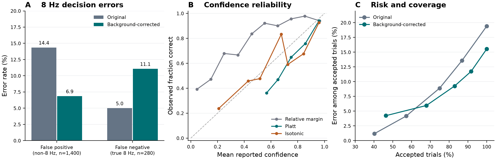

# 从 FBCCA 到可检验的正确概率

清华 Benchmark 的 35 名被试用于训练，BETA 的 70 名被试用于跨库测试。在两个公开库中，从原 40 类键盘各取 8、9、10、11、12、13 Hz 六类，对应每人 36 和 24 个实际试次。每个被试的每个区组内六类各一次。两个库都是单独的视觉选择实验。本文档中的 P 只对应当次 SSVEP 所选频率正确的概率。数据来源见 [Benchmark 原论文](https://pubmed.ncbi.nlm.nih.gov/27849543/) 和 [BETA 原论文](https://www.frontiersin.org/journals/neuroscience/articles/10.3389/fnins.2020.00627/full)。

## 计算

使用原仓库的公开 EEG 缓存与提取脚本。缺少缓存时，以下第一条命令从清华数据发布站取得原始数据。已有缓存时可直接执行第二、三条命令。执行位置为仓库根目录，Python 环境需提供 NumPy、SciPy、h5py 和 scikit-learn。

```sh
.venv312/bin/python scripts/prepare_public_ssvep_datasets.py --datasets benchmark beta
.venv312/bin/python research/serial_bci/ssvep/validate.py
.venv312/bin/python research/serial_bci/ssvep/diagnostics.py
```

六个后部通道按 O1、Oz、O2、PO3、POz、PO4 排列。采样率为 250 Hz。主窗固定为 1.5 s，Benchmark 和 BETA 分别从刺激起始后 140 ms 和 132 ms 读取。1 s、2 s 是同一试次的敏感性分析。BETA 前 15 人刺激持续 2 s，2 s 长窗的末尾包括 132 ms 刺激结束后记录。每个窗口单独去线性漂移，50 Hz 陷波、按通道标准化，再进行项目原有的 FFT 三子带 FBCCA。低截止为 6、14、22 Hz，共用上限 50 Hz。使用四次以内且频率不超过 50 Hz 的谐波，子带权重为 n 的 −1.25 次方加 0.25。数值秩阈值为最大奇异值的 1%。公共数据不设振幅门限，两个库共 2,940 个试次全部计入。

比较三种分数处理。原始方案以 FBCCA 分数 S 取最大值。对照 A 从每类分数减去同一试次其他类的均值，所得结果等于 K/(K−1) 乘以该类分数相对全类均值的差，故逐试次 argmax 与原始方案相同。对照 B 减去训练被试注视其他目标时该类的平均分数，各类具有各自的背景水平。B 使用训练标签估计分数偏置。两个公开缓存均未保存单独静息段，无法据此估计个体静息分数。

在每种决策规则内，用截断到 [0,1] 的 (最高分−次高分)/max(|最高分|,1e−12) 作为相对分差。训练标签为该规则所选类别是否正确。Platt 拟合 logistic(a+b×分差)，采用 sklearn 的 L2 正则化，C=1。Isotonic 拟合单调分段线性插值并在两端截断。第三个参照为训练试次的平均正确率。先训练再迁移到 BETA 时，训练内再按被试交叉拟合 B 的背景，最后用 Benchmark 全员重估背景。另给出库内留一被试结果。两库此前已在本项目中使用，跨库划分在本流程中隔离测试标签，整体研究仍需要新样本验证。

## 1.5 s 跨库结果

| 决策规则 | BETA 总体正确 | 非 8 Hz 判为 8 Hz | 真 8 Hz 被漏判 | 相对分差 Brier | Platt Brier | Isotonic Brier |
| --- | ---: | ---: | ---: | ---: | ---: | ---: |
| 原始 FBCCA | 1,354/1,680 | 201/1,400 | 14/280 | 0.3678 | 0.1267 | 0.1219 |
| 同试次其他类均值 | 1,354/1,680 | 201/1,400 | 14/280 | 0.1606 | 0.1328 | 0.1304 |
| 训练被试非目标背景 | 1,419/1,680 | 96/1,400 | 31/280 | 0.1754 | 0.1101 | 0.1069 |

与原始 FBCCA 相比，按候选频率减去训练非目标背景，使准确率提高 3.87 个百分点，95% 区间为 2.44 至 5.42。8 Hz 错误触发率下降 7.50 个百分点，95% 区间为 −9.79 至 −5.43，同时 8 Hz 漏检率增加 6.07 个百分点，95% 区间为 3.21 至 9.29。区间基于 10,000 次被试配对 bootstrap，对已拟合于 Benchmark 的固定模型进行被试层面重抽样。

同一背景校正决策下，恒定训练正确率、Platt 和 Isotonic 的 Brier 分别为 0.1376、0.1101 和 0.1069。Platt 和 Isotonic 的 10 个等宽箱 ECE 分别为 0.0520 和 0.0477。按 Platt P≥0.9 接受 1,141/1,680 个试次，其中 1,073 个正确。高阈值降低覆盖率。这里使用阈值仅展示 SSVEP 选择性预测，后续 MI 解码收益需用真实配对试次单独验证。

## 结果文件

- `results/metrics.csv` 提供按数据集、训练方式、窗长、分数处理和校准方法分列的统计。
- `results/trials.csv` 提供各试次预测及校准输出。使用 `dataset,split,seconds,variant,trial_id` 联合识别一行，同一试次在不同分析中重复出现。
- `results/participant_effects.csv` 记录被试配对差值及 95% 区间。`results/selective.csv` 记录按固定阈值接受的试次数、错误及总体分母。
- `results/reliability.csv` 记录主窗各决策规则的各置信度区间及有效样本数。`results/benchmark_models.json` 保存 Benchmark 全样本拟合的各窗参数及校准结点。
- `results/run.json` 保存输入 SHA256、窗长和重算耗时。本机缓存到汇总约 6 秒。原始数据下载和转换另计。



图中 A 为按真实目标类别作分母的错误率。B 为减去训练非目标背景后的概率可靠性，横纵坐标分别为箱内平均置信度和实际正确比例，仅绘制至少 10 个试次的箱，全部箱保存在 CSV 中。C 为两种 FBCCA 决策经 Platt 校准后使用 0、0.70、0.80、0.90、0.95 阈值的覆盖率和已接受试次错误率。可用 `research/serial_bci/ssvep/figure.py` 从汇总表重画 PNG 与矢量 SVG。

## 12 频附加开发分析 · 同一被试的干湿头带

Nakanishi 的 10 人共 1,800 个试次用作源数据。Wearable 的 102 人分别使用干、湿头带完成 10 个区组，每个区组包括 12 个目标。两库频率均为 9.25 至 14.75 Hz，间隔 0.5 Hz，均未设 8 Hz。这项检验回答设备变化时概率能否沿用，六频实验的 8 Hz 误触结论需在具有 8 Hz 条件的设备上检验。[Nakanishi 作者数据与事件说明](https://github.com/mnakanishi/12JFPM_SSVEP) · [Wearable 原论文](https://www.mdpi.com/1424-8220/21/4/1256)

原始 EEG 文件第三维的电极编码为 1 干、2 湿，发布方对阻抗文件采用相反编码。仓库提取脚本保留 EEG 的原始电极编码、区组号和目标索引。两个库的六个共用后部通道及 12 个目标次序相同。分别读取 Nakanishi 256 Hz 原始矩阵自零基采样下标 74 起的 512 点，经 125/128 多相重采样取得 250 Hz 缓存，以及 Wearable 自刺激后 140 ms 开始的 250 Hz 缓存。另外固定检查了 Nakanishi 第 1 人的目标索引 1、8、12 和区组 1、8、15 的九个组合，重建结果与缓存逐元素一致。[Wearable 原始 EEG 编码与采样说明](https://bci.med.tsinghua.edu.cn/upload/zhufangkun/Readme.pdf) · [原始刺激映射](https://bci.med.tsinghua.edu.cn/upload/zhufangkun/stimulation_information.pdf)

统一截取 1.5 s、375 点，其后采用上文相同的去漂移、陷波和三子带 FBCCA，仅替换 12 个参考频率。所有方法共用同一留出集。按每人每种头带划分，前 2 块 24 条可作个体校准，后 8 块 96 条只用于评价，各头带 9,792 条。全体 24,480 条中的其余 4,896 条用于校准。源参数直接迁移的对照也只在后 8 块评分。个人校准先估计该头带的逐频非目标背景，保持源 Platt 斜率，再用前两块交替留一块的 SSVEP 正误标签估计一个截距偏移。截距偏移使用零均值、标准差为 1 的高斯先验。测试不读取其他被试或同一被试另一种电极的数据。

| 方法 | 干电极准确率 | 干电极 Brier | 湿电极准确率 | 湿电极 Brier |
| --- | ---: | ---: | ---: | ---: |
| 原始 FBCCA，源 Platt | 52.05% | 0.1932 | 75.79% | 0.1213 |
| 源背景，源 Platt | 52.71% | 0.2709 | 75.43% | 0.1430 |
| 个人背景，源 Platt | 53.16% | 0.2247 | 75.89% | 0.1333 |
| 个人背景，个人截距 | 53.16% | 0.1789 | 75.89% | 0.1204 |
| 原始 FBCCA，个人截距（事后预算匹配对照） | 52.05% | 0.1661 | 75.79% | 0.1167 |

第五组作为查看前四组后的附加诊断，同样使用前 24 条标签，仅调整原始 FBCCA 的 Platt 截距。干电极上，再加个人背景使准确率增加 1.10 个百分点（95% 区间 0.44 至 1.79），Brier 同时增加 0.0128（0.0076 至 0.0179）。与六频结果合起来看，逐频校正可以改变错误分布，概率预测的迁移质量还受电极和个体影响。

直接迁移源背景和源 Platt 到干电极时，平均 P 为 73.61%，实际正确率仅 52.71%。采用个人背景和个人截距后，干电极 Brier 差为 −0.0919，按被试配对重抽样 10,000 次的 95% 区间为 −0.1156 至 −0.0703。湿电极对应差为 −0.0226，区间为 −0.0296 至 −0.0163。干电极校准后的平均 P 为 56.65%，实际正确率为 53.16%，仍存在偏高。

干电极上，个人背景、个人截距方案的低 P 组（<0.70）正确 1,950/5,906（33.02%），高 P 组（≥0.90）正确 1,687/1,776（94.99%），高 P 组覆盖全部干电极留出试次的 18.14%。湿电极分别为 1,400/3,230（43.34%）、3,957/4,022（98.38%），高 P 组覆盖 41.07%。被试内 AUROC 取有正确和错误两类结果的被试平均，干电极为 0.711（102 人），湿电极为 0.828（98 人）。对同一人的截距修正会整体平移其概率，保留试次排序，因此对该人的 AUROC 无影响。此处低 P 指当次视觉选择出错的风险，跨环节关联需同一试次后续 MI 数据验证。

重算命令如下。原始发布数据可由前述提取脚本通过 `--datasets nakanishi wearable` 转换。

```sh
.venv312/bin/python research/serial_bci/ssvep/wearable.py
```

`wearable_results/metrics.csv` 给出覆盖率所需计数、置信分箱准确率、ECE 和概率评分。`participant_effects.csv` 固定使用同一人的差值。`subject_metrics.csv` 和压缩的 `trials.csv.gz` 支持重算。`source_models.json` 与 `run.json` 保存模型系数、源文件校验码和拆分说明。

## 与已发表的 SSVEP 可靠性估计思路比较

Zhang 等从最高分与其他候选分的差构造特征，分别对判对和判错的试次拟合 GMM，再由贝叶斯后验估计置信度。我们用同一批 1.5 s 去背景 FBCCA 决策实现其思路的变体，加入判别式五维岭逻辑回归对照。原论文有自己的基础分类器、训练范式与决策规则，本次比较记录本项目的六频 FBCCA 设置。[Zhang 等原论文作者稿](https://eprints.whiterose.ac.uk/id/eprint/199879/)

在 Benchmark 对 35 人留一交叉估计背景。将每条试次六个校正分数排序，计算第一名分别减去第二至第六名的五个绝对分差。五个特征均按 Benchmark 训练均值和标准差标准化。训练得到 1,165 个正确、95 个错误。GMM 每类固定 2 个分量、全协方差、对角正则 0.01，固定初始种子、独立初始化 3 次，仅在源库拟合，贝叶斯先验取源训练正误比例。五维逻辑回归用 L2 正则、C=1。BETA 测试统一使用由全部 Benchmark 估计的背景，同一批 1,680 个决策中正确 1,419 个。下表的 ECE 使用 10 个等宽概率箱，对数损失限制概率在 [0.000001,0.999999]。

| 正确概率估计 | 外库 Brier | 外库对数损失 | ECE | 判别正确性的 AUROC |
| --- | ---: | ---: | ---: | ---: |
| 一维分差 Platt | 0.1101 | 0.3627 | 0.0520 | 0.7969 |
| 一维分差 Isotonic | 0.1069 | 0.3591 | 0.0477 | 0.7981 |
| 五个分差岭逻辑回归 | 0.0905 | 0.2869 | 0.0338 | 0.8943 |
| 五个分差的类条件 GMM 后验 | 0.0944 | 0.2992 | 0.0295 | 0.8835 |

相对 Platt，五维岭回归的 Brier 差为 −0.0195（被试配对 bootstrap 95% 区间 −0.0283 至 −0.0112），GMM 对应 −0.0157（−0.0262 至 −0.0056）。使用第二到第六名的分差也保留了绝对分差尺度，实验无法拆分增加对手数量和保留尺度各自的贡献。首次六频结果后增加本次方法学对照，外库已被反复评估，最终校准器还需在新的串行样本上验证。

在与 IV2a 独立均匀抽样组成的工程回放中，使用相同的 MI 概率和相同配对权重。各方法的联合 Brier、联合对数损失和 80% 覆盖处的双正确率如下。

| 视觉端输入 | Brier | 对数损失 | 80% 覆盖双正确率 |
| --- | ---: | ---: | ---: |
| 固定源正确率，无逐试次 P | 0.2360 | 0.6705 | 62.00% |
| 一维 Platt | 0.2195 | 0.6284 | 63.39% |
| 一维 Isotonic | 0.2178 | 0.6258 | 63.58% |
| 五维岭逻辑回归 | 0.2084 | 0.6023 | 64.65% |
| GMM 后验 | 0.2087 | 0.6034 | 64.12% |

这些数字描述 1,680 次外部视觉试次与 1,296 次不同人群 MI 试次的笛卡尔积。改善可以完全来自更好地估计视觉决策本身是否正确。双正确风险、后续 MI 类别正确率、同人秒级跨环节生理影响需要分别检验。

```sh
.venv312/bin/python research/serial_bci/ssvep/literature_comparator.py
.venv312/bin/python research/serial_bci/ssvep/comparator_replay.py
```

`comparator_results/trials.csv` 包括 1,680 行一一对应的外库预测，`metrics.csv` 给出对 Platt 的 Brier、对数损失差及区间与 ECE 差。`benchmark_models.json` 保存源库背景、特征标准化参数、逻辑回归系数与 GMM 参数。`independent_replay.json` 为各校准器的同覆盖回放，并保留两个人群分别重抽样的差值区间。模块函数 `frozen_gap_logit` 接收已经减过背景的六列分数和该模型 JSON，返回源逻辑回归 logit。
